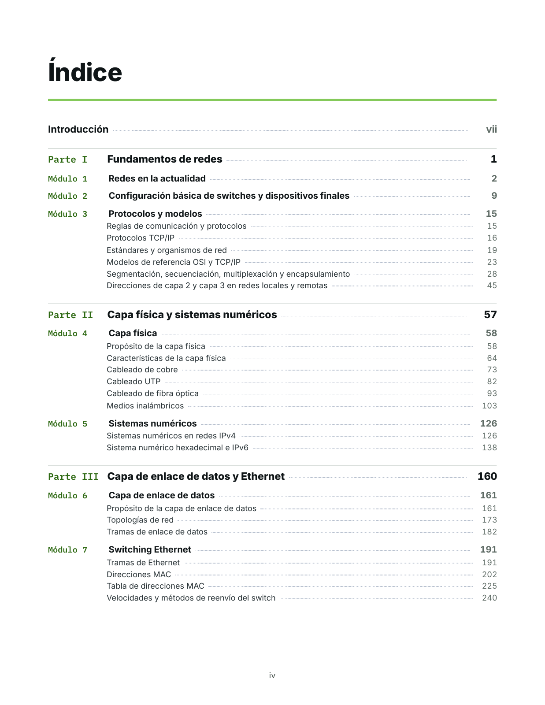
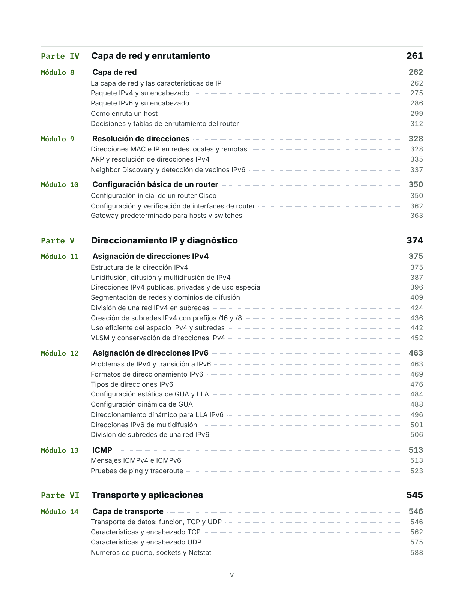
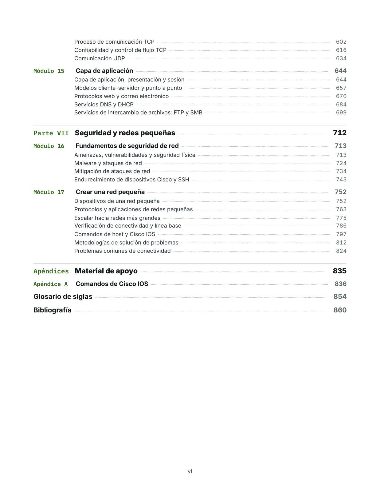

# Introducción a las Redes

Un libro en español para entender cómo funcionan las redes de datos: desde los medios físicos y Ethernet hasta IPv4, IPv6, los servicios de red y la seguridad básica.

<p align="center">
  <a href="https://github.com/wh01s17/book-introduccion-a-las-redes/releases/latest/download/introduccion-a-las-redes.pdf">
    
  </a>
</p>

<p align="center">
  <a href="https://github.com/wh01s17/book-introduccion-a-las-redes/releases/latest/download/introduccion-a-las-redes.pdf"><strong>Descargar libro completo (PDF · 21,8 MB)</strong></a><br>
  <a href="#contenido">Descargar por módulo</a> · <a href="#vista-previa-del-índice">Ver el índice</a> · <a href="https://github.com/wh01s17/book-introduccion-a-las-redes/releases">Todas las versiones</a>
</p>

**Jordy Pérez** · Versión **1.0.3** · Octubre de 2026 · **871 páginas** · ISBN 978-956-03-1451-2 · [CC BY-NC-SA 4.0](LICENSE.md)

Combina explicaciones conceptuales, diagramas originales, tablas de referencia y ejemplos de configuración en Cisco IOS. Sus **17 módulos, organizados en siete partes**, siguen la secuencia del temario CCNA: Introducción a las Redes (ITN). Incluye una referencia de comandos, un glosario de siglas y bibliografía.

Esta edición reúne los contenidos teóricos, sin preguntas, ejercicios ni actividades prácticas.

> **Aviso:** este libro es material de estudio independiente, elaborado a partir de las notas personales de estudio de CCNA del autor. **No es una publicación oficial de Cisco Systems ni de Cisco Networking Academy**, no está respaldado por ellas y no reemplaza la documentación de los fabricantes.

## Descarga

Los PDF se publican en la sección [Releases](https://github.com/wh01s17/book-introduccion-a-las-redes/releases) del repositorio. Los enlaces de esta página descargan siempre la edición más reciente.

| Documento | Formato | Tamaño |
| --- | --- | --: |
| [**Libro completo: Introducción a las Redes**](https://github.com/wh01s17/book-introduccion-a-las-redes/releases/latest/download/introduccion-a-las-redes.pdf) | PDF, 871 páginas, con índice enlazado y marcadores | 21,8 MB |
| Módulos individuales (ver [Contenido](#contenido)) | 17 PDF, uno por módulo, con marcadores por sección | 28,2 MB en total |

Cada PDF por módulo incluye la portada, la página legal y las páginas del módulo con la misma numeración que el libro completo.

Las ediciones anteriores siguen disponibles en [todas las versiones](https://github.com/wh01s17/book-introduccion-a-las-redes/releases). Cada versión incluye el archivo `SHA256SUMS.txt` para comprobar la integridad de las descargas.

<details>
<summary>Cómo verificar los archivos descargados</summary>

Descarga `SHA256SUMS.txt` desde la misma versión que los PDF y guárdalo en la misma carpeta. Desde esa carpeta, ejecuta en Linux:

```sh
sha256sum --ignore-missing -c SHA256SUMS.txt
```

La opción `--ignore-missing` permite verificar solo los archivos que descargaste. Cada PDF verificado debe mostrar `OK` o `La suma coincide`, según el idioma del sistema.

</details>

## Vista previa del índice

Estas son las tres páginas del índice de la **versión 1.0.3**, extraídas del PDF publicado. Haz clic en cada captura para verla en tamaño completo.

| Índice · página iv | Índice · página v | Índice · página vi |
| :---: | :---: | :---: |
| [](assets/images/indice-01.png) | [](assets/images/indice-02.png) | [](assets/images/indice-03.png) |

## A quién está dirigido

- Personas que comienzan a estudiar redes de datos y buscan una explicación ordenada de sus fundamentos.
- Estudiantes que preparan el curso CCNA: Introducción a las Redes y quieren un texto de consulta en español que acompañe su estudio.

Cada sigla se explica la primera vez que aparece, en español y con su forma original en inglés.

Puedes leerlo en orden para avanzar desde los fundamentos o descargar un módulo como texto de consulta. El índice enlazado y los marcadores del PDF permiten saltar entre secciones; la referencia de comandos y el glosario reúnen el material de apoyo al final del libro.

## Contenido

El libro avanza en siete partes, desde la capa física hasta las aplicaciones, la seguridad y la operación de una red pequeña. Al final incluye una referencia de comandos de Cisco IOS, un glosario de siglas y la bibliografía.

La columna «Páginas» indica las páginas de cada PDF individual, incluidas la portada y la página legal.

**Parte I · Fundamentos de redes**

| Módulo | Título | Páginas | Descarga |
| --: | --- | --: | --- |
| 1 | Redes en la actualidad | 9 | [PDF (0,8 MB)](https://github.com/wh01s17/book-introduccion-a-las-redes/releases/latest/download/modulo-01-redes-en-la-actualidad.pdf) |
| 2 | Configuración básica de switches y dispositivos finales | 8 | [PDF (0,7 MB)](https://github.com/wh01s17/book-introduccion-a-las-redes/releases/latest/download/modulo-02-configuracion-basica-de-switches-y-dispositivos-finales.pdf) |
| 3 | Protocolos y modelos | 43 | [PDF (1,4 MB)](https://github.com/wh01s17/book-introduccion-a-las-redes/releases/latest/download/modulo-03-protocolos-y-modelos.pdf) |

**Parte II · Capa física y sistemas numéricos**

| Módulo | Título | Páginas | Descarga |
| --: | --- | --: | --- |
| 4 | Capa física | 70 | [PDF (2,4 MB)](https://github.com/wh01s17/book-introduccion-a-las-redes/releases/latest/download/modulo-04-capa-fisica.pdf) |
| 5 | Sistemas numéricos | 36 | [PDF (1,3 MB)](https://github.com/wh01s17/book-introduccion-a-las-redes/releases/latest/download/modulo-05-sistemas-numericos.pdf) |

**Parte III · Capa de enlace de datos y Ethernet**

| Módulo | Título | Páginas | Descarga |
| --: | --- | --: | --- |
| 6 | Capa de enlace de datos | 32 | [PDF (1,2 MB)](https://github.com/wh01s17/book-introduccion-a-las-redes/releases/latest/download/modulo-06-capa-de-enlace-de-datos.pdf) |
| 7 | Switching Ethernet | 73 | [PDF (2,1 MB)](https://github.com/wh01s17/book-introduccion-a-las-redes/releases/latest/download/modulo-07-switching-ethernet.pdf) |

**Parte IV · Capa de red y enrutamiento**

| Módulo | Título | Páginas | Descarga |
| --: | --- | --: | --- |
| 8 | Capa de red | 68 | [PDF (2,0 MB)](https://github.com/wh01s17/book-introduccion-a-las-redes/releases/latest/download/modulo-08-capa-de-red.pdf) |
| 9 | Resolución de direcciones | 24 | [PDF (1,0 MB)](https://github.com/wh01s17/book-introduccion-a-las-redes/releases/latest/download/modulo-09-resolucion-de-direcciones.pdf) |
| 10 | Configuración básica de un router | 26 | [PDF (1,1 MB)](https://github.com/wh01s17/book-introduccion-a-las-redes/releases/latest/download/modulo-10-configuracion-basica-de-un-router.pdf) |

**Parte V · Direccionamiento IP y diagnóstico**

| Módulo | Título | Páginas | Descarga |
| --: | --- | --: | --- |
| 11 | Asignación de direcciones IPv4 | 90 | [PDF (2,6 MB)](https://github.com/wh01s17/book-introduccion-a-las-redes/releases/latest/download/modulo-11-asignacion-de-direcciones-ipv4.pdf) |
| 12 | Asignación de direcciones IPv6 | 52 | [PDF (1,8 MB)](https://github.com/wh01s17/book-introduccion-a-las-redes/releases/latest/download/modulo-12-asignacion-de-direcciones-ipv6.pdf) |
| 13 | ICMP | 34 | [PDF (1,3 MB)](https://github.com/wh01s17/book-introduccion-a-las-redes/releases/latest/download/modulo-13-icmp.pdf) |

**Parte VI · Transporte y aplicaciones**

| Módulo | Título | Páginas | Descarga |
| --: | --- | --: | --- |
| 14 | Capa de transporte | 100 | [PDF (2,7 MB)](https://github.com/wh01s17/book-introduccion-a-las-redes/releases/latest/download/modulo-14-capa-de-transporte.pdf) |
| 15 | Capa de aplicación | 70 | [PDF (2,0 MB)](https://github.com/wh01s17/book-introduccion-a-las-redes/releases/latest/download/modulo-15-capa-de-aplicacion.pdf) |

**Parte VII · Seguridad y redes pequeñas**

| Módulo | Título | Páginas | Descarga |
| --: | --- | --: | --- |
| 16 | Fundamentos de seguridad de red | 41 | [PDF (1,4 MB)](https://github.com/wh01s17/book-introduccion-a-las-redes/releases/latest/download/modulo-16-fundamentos-de-seguridad-de-red.pdf) |
| 17 | Crear una red pequeña | 85 | [PDF (2,4 MB)](https://github.com/wh01s17/book-introduccion-a-las-redes/releases/latest/download/modulo-17-crear-una-red-pequena.pdf) |

**Apéndices · Material de apoyo**

El apéndice A (referencia de comandos de Cisco IOS), el glosario de siglas y la bibliografía están incluidos en el [libro completo](https://github.com/wh01s17/book-introduccion-a-las-redes/releases/latest/download/introduccion-a-las-redes.pdf).

## Erratas y sugerencias

Si encuentras un error técnico, una errata o un enlace que no funciona:

1. [Abre un *issue*](https://github.com/wh01s17/book-introduccion-a-las-redes/issues/new). Indica el documento (libro completo o módulo), su versión, el número de página impreso y la sección, y describe brevemente el problema y la corrección propuesta.
2. Si prefieres proponer el cambio directamente, envía un *pull request*. Este repositorio contiene los PDF ya generados, así que describe en el PR la página, el texto actual y el texto corregido; la corrección se incorporará en la siguiente versión del libro.
3. También puedes escribir mediante el formulario de contacto de [wh01s17.com](https://www.wh01s17.com/#contact).

Las correcciones se publican como nuevas versiones y se registran en el [CHANGELOG](CHANGELOG.md).

## Licencia

© 2026 Jordy Pérez. El contenido original de esta obra, incluidos el texto y los diagramas, se distribuye bajo la licencia [Creative Commons Atribución-NoComercial-CompartirIgual 4.0 Internacional (CC BY-NC-SA 4.0)](https://creativecommons.org/licenses/by-nc-sa/4.0/deed.es). Puedes copiarla, distribuirla y adaptarla siempre que:

- cites al autor;
- no la uses con fines comerciales;
- compartas las adaptaciones con la misma licencia.

La licencia cubre solo el contenido original. Cisco, Cisco IOS, CCNA, Cisco Networking Academy, Packet Tracer y Meraki son marcas comerciales o marcas registradas de Cisco Systems, Inc. Las demás marcas mencionadas pertenecen a sus respectivos titulares y se citan solo con fines descriptivos. Consulta los detalles en [LICENSE.md](LICENSE.md).

## Autor

**Jordy Pérez**

- [wh01s17.com](https://www.wh01s17.com/)
- [sudoaprende.com](https://www.sudoaprende.com/)
